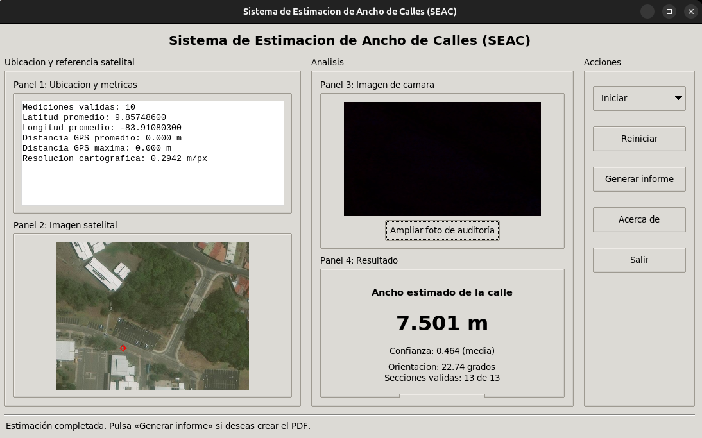

# SEAC — Sistema de Estimación de Ancho de Calles

**Proyecto de Aplicación de la Ingeniería en Computadores (CE-1114)**  
**Instituto Tecnológico de Costa Rica (TEC) · II semestre de 2026**  
**Desarrollado por:** Javier Tenorio Cervantes

## Descripción

El **Sistema de Estimación de Ancho de Calles (SEAC)** es un prototipo que estima el ancho de una vía a partir de su **ubicación GPS** y del **análisis geométrico de imágenes satelitales**. Utiliza una **Raspberry Pi 4**, un receptor **NEO-6M** y, de manera complementaria, una **cámara** para registrar evidencia visual de la escena analizada.

El resultado principal es un **ancho estimado en metros**, acompañado de información geográfica, un indicador de confianza y evidencias del procesamiento. El sistema incluye una **interfaz gráfica en Tkinter**, salidas en **JSON** y la posibilidad de **generar un informe PDF** a solicitud del usuario.

El objetivo es proporcionar un parámetro geométrico que pueda apoyar la calibración de soluciones externas de estimación de velocidad vehicular, por ejemplo, aquellas basadas en **YOLO**. **SEAC no detecta vehículos ni calcula su velocidad**: su responsabilidad es estimar y entregar información sobre el ancho de la vía.

> **Estado del proyecto:** prototipo funcional en desarrollo y evaluación. El ancho se calcula mediante imágenes satelitales; la fotografía de cámara se emplea actualmente como **evidencia de auditoría**, no para corregir numéricamente la estimación satelital. El resultado no sustituye una medición física certificada.

## Contenido

1. [Características principales](#1-características-principales)
2. [Arquitectura y flujo de funcionamiento](#2-arquitectura-y-flujo-de-funcionamiento)
3. [Hardware y software](#3-hardware-y-software)
4. [Organización del proyecto](#4-organización-del-proyecto)
5. [Instalación y preparación](#5-instalación-y-preparación)
6. [Ejecución del sistema](#6-ejecución-del-sistema)
7. [Interfaz gráfica de usuario](#7-interfaz-gráfica-de-usuario)
8. [Adquisición y procesamiento GPS](#8-adquisición-y-procesamiento-gps)
9. [Obtención de imágenes satelitales](#9-obtención-de-imágenes-satelitales)
10. [Algoritmo de estimación del ancho](#10-algoritmo-de-estimación-del-ancho)
11. [Captura de cámara y auditoría visual](#11-captura-de-cámara-y-auditoría-visual)
12. [Generación del informe PDF](#12-generación-del-informe-pdf)
13. [Archivos de salida y reporte JSON](#13-archivos-de-salida-y-reporte-json)
14. [Parámetros del pipeline](#14-parámetros-del-pipeline)
15. [Limitaciones y criterios de evaluación](#15-limitaciones-y-criterios-de-evaluación)
16. [Solución de problemas frecuentes](#16-solución-de-problemas-frecuentes)
17. [Referencias y atribuciones](#17-referencias-y-atribuciones)

---

## 1. Características principales

- **Adquisición GPS:** permite obtener nuevas mediciones del NEO-6M o reutilizar un archivo de coordenadas previamente adquirido.
- **Procesamiento estadístico:** determina una ubicación representativa a partir de un conjunto de mediciones válidas e informa su dispersión.
- **Georreferenciación:** descarga teselas de **Esri World Imagery**, construye un mosaico y localiza el punto GPS dentro de la imagen.
- **Estimación geométrica:** analiza tonos de gris, textura, bordes y segmentos lineales para localizar los límites de la vía y estimar su ancho en metros.
- **Evaluación de confianza:** informa la calidad de la estimación e identifica escenarios ambiguos.
- **Fotografía de auditoría:** obtiene una imagen de la cámara y le superpone fecha, ubicación GPS y ancho estimado cuando se dispone de esos datos.
- **Interfaz gráfica:** reúne coordenadas, métricas GPS, imagen satelital, foto de cámara, resultado y acciones de ejecución.
- **Evidencias y reportes:** conserva las imágenes intermedias y el `reporte.json`; puede generar un PDF sin repetir la estimación.

---

## 2. Arquitectura y flujo de funcionamiento

El software utiliza una arquitectura **modular, de procesamiento secuencial por etapas**. La interfaz es una capa de presentación que reutiliza la lógica de `seac_pipeline.py`.

```text
                      ┌───────────────────────────┐
                      │     Interfaz Tkinter      │
                      │     interfaz_seac.py      │
                      └─────────────┬─────────────┘
                                    │
                  ┌─────────────────┴─────────────────┐
                  │                                   │
          Usar coordenadas                    Actualizar coordenadas
             existentes                                │
                  │                            GPS.py + NEO-6M
                  │                                   │
                  └─────────────────┬─────────────────┘
                                    │
                           mediciones_gps.txt
                                    │
                                    ▼
                       ┌────────────────────────┐
                       │    seac_pipeline.py    │
                       │  Coordinador del flujo │
                       └────────────┬───────────┘
                                    │
                              gps.py
                        Análisis estadístico
                                    │
                         Coordenada promedio
                                    ▼
                               esri.py
                  Teselas Esri + mosaico + escala
                                    │
                                    ▼
                         estimacion_ancho.py
                  Detección de límites de la vía
                                    │
                           Ancho + confianza
                                    │
                ┌───────────────────┴──────────────────┐
                │                                      │
                ▼                                      ▼
         Evidencia satelital                        camara.py
        + resultados geométricos                Foto de auditoría
                │                                      │
                └───────────────────┬──────────────────┘
                                    │
                            resultados_seac/
                        Imágenes + reporte.json
                                    │
                         Solicitud del usuario
                                    ▼
                               reporte.py
                             Informe PDF
```

La **cámara es una fuente complementaria y opcional**. Una falla de captura no implica necesariamente que deba fallar el análisis satelital; su disponibilidad y el motivo del fallo se pueden registrar en el reporte.

**Flujo resumido de una ejecución:**

1. Seleccionar el origen de las coordenadas GPS.
2. Leer las mediciones y calcular la posición promedio.
3. Obtener y georreferenciar el mosaico satelital.
4. Detectar la orientación y los dos bordes de la calle.
5. Medir varias secciones transversales y calcular el ancho y su confianza.
6. Registrar, si está habilitada y disponible, una fotografía de referencia.
7. Guardar las evidencias y mostrar el resultado en la interfaz.
8. **Opcionalmente**, generar un informe PDF con las salidas ya existentes.

---

## 3. Hardware y software

### 3.1. Hardware

| Componente | Función |
| --- | --- |
| **Raspberry Pi 4** | Ejecuta los programas Python y coordina los periféricos. |
| **GPS NEO-6M** | Proporciona coordenadas y datos de calidad de posicionamiento a través de comunicación serial. |
| **Cámara USB o compatible con OpenCV** | Captura una fotografía de la escena vial para auditoría. |
| **Conexión a Internet** | Permite obtener las imágenes desde el servicio satelital de Esri. |
| **Pantalla o sesión gráfica remota** | Permite utilizar la interfaz Tkinter. |

El módulo GPS se comunica mediante **UART**. En un montaje UART convencional, el **TX del GPS** se conecta al **RX de la Raspberry Pi**, con **tierra común**; las conexiones restantes dependen del modelo y del método de comunicación utilizado. Se deben respetar los niveles eléctricos y el voltaje de alimentación indicados por el fabricante del módulo. La configuración serial documentada inicialmente utiliza **9600 baudios**; verificarla en `GPS.py` y en el dispositivo antes de operar.

### 3.2. Software y bibliotecas

El prototipo utiliza **Python 3** y las siguientes herramientas:

| Herramienta | Uso principal |
| --- | --- |
| **OpenCV (`cv2`)** | Captura de cámara y procesamiento de imágenes. |
| **NumPy** | Operaciones numéricas y estadísticas. |
| **Pillow (`PIL`)** | Carga y escalado de imágenes en la interfaz y el PDF. |
| **Tkinter / `ttk`** | Interfaz gráfica de escritorio. |
| **ReportLab** | Generación de documentos PDF. |
| **`v4l2-ctl`** (Linux, opcional) | Ajuste de exposición, balance de blancos y ganancia de cámaras compatibles. |
| **Bibliotecas de GPS y puerto serial** | Lectura de mensajes NMEA y del dispositivo, según la implementación de `GPS.py`. |

Los módulos de la biblioteca estándar, como `json`, `argparse`, `subprocess`, `pathlib`, `threading`, `math`, `os` y `datetime`, no requieren instalación mediante `pip`.

---

## 4. Organización del proyecto

Esta es la organización lógica de los archivos utilizados por el sistema. Algunos nombres y carpetas pueden variar según la versión del repositorio; los módulos **deben conservar los nombres importados por el código**.

```text
SEAC/
├── README.md
├── GPS.py                       # Adquisición de nuevas mediciones NEO-6M
├── gps.py                       # Lectura y análisis estadístico del archivo GPS
├── esri.py                      # Descarga y georreferenciación del mosaico
├── estimacion_ancho.py          # Algoritmo de estimación geométrica
├── seac_pipeline.py             # Coordinación de las etapas del sistema
├── camara.py                    # Captura y fotografía de auditoría
├── interfaz_seac.py             # Interfaz gráfica en Tkinter
├── reporte.py                   # Generación independiente del informe PDF
├── acerca_de.py                # Ventana informativa de la interfaz
├── mediciones_gps.txt           # Mediciones disponibles (generadas o existentes)
├── docs/
│   ├── interfaz_text.png        # Captura de la interfaz (agregada al repositorio)
│   ├── mediciones.jpeg
│   ├── tabla_promedio.png
│   └── imagen_sat.png
└── resultados_seac/             # Archivos generados al ejecutar el pipeline
```

**Responsabilidades:**

- `GPS.py` **adquiere** coordenadas desde el hardware; `gps.py` **analiza** las coordenadas almacenadas. Son dos módulos diferentes.
- `seac_pipeline.py` coordina el procesamiento y produce los archivos de salida.
- `interfaz_seac.py` presenta los resultados y ejecuta las operaciones sin duplicar el algoritmo.
- `camara.py` documenta visualmente la escena, pero no sustituye el análisis satelital.
- `reporte.py` transforma el JSON y las imágenes existentes en un PDF; **no vuelve a ejecutar** la descarga ni la estimación.

> **Importante:** la interfaz importa `acerca_de.py` y `seac_pipeline.py`, y busca `GPS.py` junto a `interfaz_seac.py`. Para desplegar el proyecto deben estar disponibles esos archivos y los demás módulos referenciados por el pipeline.

---

## 5. Instalación y preparación

### 5.1. Requisitos previos

- Python 3 instalado.
- Cámara reconocida por OpenCV, si se desea obtener fotografías.
- Receptor NEO-6M conectado y accesible, si se van a actualizar coordenadas.
- Internet disponible para descargar el mosaico satelital.
- Un entorno gráfico operativo para iniciar la interfaz.

En Raspberry Pi OS o Linux basado en Debian se pueden instalar las dependencias de sistema con:

```bash
sudo apt update
sudo apt install python3-pip python3-venv python3-tk v4l-utils
```

Desde la carpeta del proyecto, es recomendable utilizar un entorno virtual:

```bash
python3 -m venv --system-site-packages .venv
source .venv/bin/activate
python3 -m pip install numpy opencv-python Pillow reportlab
```

Las dependencias específicas de `GPS.py` (por ejemplo, `pyserial` o `pynmea2`, **si ese archivo las importa**) deben instalarse también:

```bash
python3 -m pip install pyserial pynmea2
```

La instalación de estas dos últimas bibliotecas depende de la implementación real del módulo GPS. Si el repositorio dispone de un `requirements.txt` actualizado, puede utilizarse como fuente principal de dependencias.

### 5.2. Comprobar el entorno

Verificar que las bibliotecas principales se puedan importar:

```bash
python3 -c "import cv2, numpy, PIL, reportlab, tkinter; print('Dependencias principales disponibles')"
```

Para comprobar la detección de una cámara en Linux:

```bash
ls /dev/video*
v4l2-ctl --list-devices
```

Para acceder a la interfaz por **SSH con reenvío X11**, se necesita un servidor gráfico X en el equipo cliente y una configuración SSH que permita el reenvío. Por ejemplo:

```bash
ssh -X usuario@direccion-de-la-raspberry
```

La disponibilidad de X11 y la capacidad de abrir visores externos (por ejemplo, el visor PDF) dependen de la configuración de la sesión remota.

---

## 6. Ejecución del sistema

### 6.1. Ejecución desde la interfaz gráfica (recomendada)

Desde la raíz del proyecto:

```bash
python3 interfaz_seac.py mediciones_gps.txt
```

La aplicación utiliza el mismo analizador de argumentos del pipeline. El archivo `mediciones_gps.txt` es necesario al seleccionar **Usar últimas coordenadas**; si se selecciona **Actualizar coordenadas**, la interfaz ejecuta `GPS.py` para producir el archivo antes de iniciar la estimación.

Una vez abierta la interfaz, elegir una de las dos opciones del botón **Iniciar**:

- **Usar últimas coordenadas:** procesa el archivo GPS indicado sin volver a consultar el receptor.
- **Actualizar coordenadas:** obtiene nuevas mediciones del NEO-6M y, una vez completada la adquisición, continúa automáticamente con el pipeline.

Al finalizar se muestran las métricas GPS, la imagen satelital, la fotografía de cámara cuando existe y el ancho calculado.

### 6.2. Ejecución por línea de comandos

Para ejecutar únicamente el pipeline:

```bash
python3 seac_pipeline.py mediciones_gps.txt
```

Ejemplo con parámetros de análisis:

```bash
python3 seac_pipeline.py mediciones_gps.txt --roi-metros 20 --ancho-maximo-m 10 --mostrar
```

Para ver las opciones realmente aceptadas por la versión instalada:

```bash
python3 seac_pipeline.py --help
python3 interfaz_seac.py --help
```

### 6.3. Adquisición GPS independiente

La actualización de coordenadas también puede ejecutarse sin abrir la interfaz:

```bash
python3 GPS.py
```

Este módulo debe finalizar correctamente y dejar disponibles las mediciones en `mediciones_gps.txt` para que el pipeline pueda analizarlas. El nombre y ubicación del archivo de salida deben ser compatibles con la configuración utilizada.

---

## 7. Interfaz gráfica de usuario

La interfaz está implementada en **Tkinter / `ttk`** dentro de `interfaz_seac.py`. Separa la presentación de los resultados del procesamiento; invoca directamente `ejecutar_pipeline()` desde `seac_pipeline.py` y lee los archivos generados en la carpeta de resultados.



*Figura. Interfaz gráfica del SEAC. La imagen debe añadirse en `docs/interfaz_text.png` para que GitHub la muestre correctamente.*

### 7.1. Distribución de los paneles

| Panel | Información presentada |
| --- | --- |
| **1. Ubicación y métricas** | Cantidad de mediciones, latitud y longitud promedio, distancias de dispersión GPS, resolución cartográfica y métricas adicionales cuando están disponibles. |
| **2. Imagen satelital** | Mosaico descargado con la posición GPS marcada (`02_imagen_con_gps.png`). |
| **3. Imagen de cámara** | Fotografía de auditoría, si se capturó. Incluye la opción **Ampliar foto de auditoría** para verla con mayor detalle. |
| **4. Resultado** | Ancho estimado en metros, confianza del algoritmo, orientación y cantidad de secciones transversales válidas. |

La ventana incorpora una barra inferior que informa el estado actual de la operación: lista para iniciar, adquiriendo GPS, procesando, estimación completada, generación del PDF o error.

### 7.2. Botones y acciones

| Control | Comportamiento |
| --- | --- |
| **Iniciar → Usar últimas coordenadas** | Valida los argumentos, comprueba que exista el archivo de entrada y ejecuta el pipeline usando esas mediciones. |
| **Iniciar → Actualizar coordenadas** | Ejecuta `GPS.py`, comprueba su terminación y el archivo de mediciones, y después inicia la estimación. |
| **Reiniciar** | Limpia los datos e imágenes mostrados en la ventana. **No elimina** las evidencias guardadas en disco. |
| **Generar informe** | Se habilita después de completar el análisis y genera el PDF a partir de sus resultados. |
| **Acerca de** | Abre la información del sistema mediante `acerca_de.py`. |
| **Salir** | Cierra la aplicación. |
| **Análisis satelital** | Abre `06_secciones_transversales.png` en una ventana independiente. |
| **Ampliar foto de auditoría** | Muestra la fotografía de cámara en un tamaño mayor, si está disponible. |

### 7.3. Opciones de inicio y actualización GPS

**Opción A — Usar últimas coordenadas**

```text
Seleccionar "Usar últimas coordenadas"
                ↓
Leer mediciones_gps.txt existente
                ↓
Ejecutar seac_pipeline.py
                ↓
Mostrar resultados
```

Esta opción es útil para repetir pruebas del algoritmo sobre una misma ubicación sin esperar una nueva adquisición GPS.

**Opción B — Actualizar coordenadas**

```text
Seleccionar "Actualizar coordenadas"
                ↓
Ejecutar GPS.py (NEO-6M)
                ↓
Generar/actualizar mediciones_gps.txt
                ↓
Comprobar finalización y archivo
                ↓
Ejecutar seac_pipeline.py
                ↓
Mostrar resultados
```

La interfaz espera **10 registros GPS** antes de continuar. Específicamente, después de que termina `GPS.py`, verifica que su proceso haya finalizado sin error, que exista `mediciones_gps.txt` y que contenga **al menos 10 líneas no vacías**. La adquisición y validación técnica de cada registro corresponden a `GPS.py` y al procesamiento GPS; la comprobación de la interfaz, por sí sola, no certifica la precisión del posicionamiento.

Si ocurre un error en la actualización, **no se inicia el procesamiento satelital** y se muestra un mensaje explicativo.

### 7.4. Ejecución sin bloquear la ventana

La interfaz utiliza hilos para realizar la adquisición GPS, el pipeline y la generación del PDF sin bloquear el ciclo principal de Tkinter. Mientras una operación está en curso, desactiva temporalmente los controles correspondientes y actualiza el estado visible para evitar ejecuciones duplicadas.

### 7.5. Comportamiento del informe y de la cámara

- El archivo **PDF no se crea automáticamente** al terminar una estimación; el usuario debe pulsar **Generar informe**.
- El botón de informe permanece deshabilitado hasta que exista una ejecución con `reporte.json`.
- Si no se obtuvo fotografía de cámara, el panel comunica el motivo registrado. La ausencia de la foto no invalida automáticamente el ancho satelital.
- Al realizar una nueva ejecución se limpia la fotografía anterior para evitar asociar visualmente una escena vieja con una medición nueva.

---

## 8. Adquisición y procesamiento GPS

El NEO-6M proporciona datos de posicionamiento mediante mensajes **NMEA**. El flujo distingue la **adquisición**, gestionada por `GPS.py`, del **análisis estadístico**, realizado por `gps.py`.

### 8.1. Mediciones y validación

Se utiliza un conjunto objetivo de **10 mediciones GPS válidas**. La documentación inicial del proyecto contempla la revisión de coordenadas, satélites y **HDOP** (dilución horizontal de la precisión), además de un intervalo entre muestras para evitar registrar varias lecturas prácticamente simultáneas. Los umbrales exactos que estén vigentes deben comprobarse en el `GPS.py` desplegado.

El formato de registro utilizado por el procesamiento es:

```text
GPS,indice,latitud,longitud,satelites,HDOP
```

| Campo | Descripción |
| --- | --- |
| `GPS` | Identificador del tipo de registro. |
| `indice` | Número o consecutivo de la medición. |
| `latitud` / `longitud` | Coordenadas geográficas de la muestra. |
| `satelites` | Número de satélites reportados. |
| `HDOP` | Indicador de calidad geométrica horizontal. |


### 8.2. Análisis estadístico

En lugar de depender de una sola lectura GPS, `gps.py` procesa el conjunto de mediciones disponibles y calcula una posición representativa mediante la **latitud y longitud promedio**.

Entre las métricas del procesamiento GPS se encuentran:

- Cantidad de mediciones disponibles y válidas.
- Latitud y longitud promedio.
- Valores mínimos y máximos de las coordenadas.
- Desviación estándar y rangos de coordenadas.
- Distancia de cada medición al punto promedio.
- Distancia promedio y máxima, expresadas en metros.

El número de satélites y el HDOP forman parte de los datos registrados, pero **no equivalen por sí solos a la coordenada final**. La interfaz muestra métricas adicionales de satélites, HDOP o dispersión únicamente si el reporte las incluye.


> **Consideración geométrica:** el promedio GPS no tiene que coincidir exactamente con el centro de la calle. Una medición tomada desde una acera o cerca del borde vial puede situar el punto de referencia fuera de la calzada. El algoritmo de estimación intenta tolerar ese desplazamiento dentro de ciertos límites.

---

## 9. Obtención de imágenes satelitales

El módulo `esri.py` utiliza las coordenadas promedio para localizar la región de interés mediante **Esri World Imagery**, a través de su servicio de teselas.

### 9.1. Coordenadas, teselas y mosaico

Las coordenadas geográficas se transforman a la cuadrícula utilizada por **Web Mercator**:

```text
Latitud y longitud promedio
              ↓
       Web Mercator
              ↓
  Posición global en píxeles
              ↓
     Tesela central X/Y
              ↓
      Mosaico de imagen
```

Una tesela tiene **256 × 256 píxeles** y se identifica mediante su nivel de zoom (`z`) y las coordenadas (`x`, `y`) del mosaico global.

La configuración documentada por defecto utiliza:

| Configuración | Valor |
| --- | --- |
| Nivel de zoom | `19` |
| Radio de teselas | `1` |
| Mosaico resultante | `3 × 3` teselas |
| Dimensión del mosaico | `768 × 768` píxeles |

```text
┌───────────┬───────────┬───────────┐
│ X-1,Y-1   │ X,Y-1     │ X+1,Y-1   │
├───────────┼───────────┼───────────┤
│ X-1,Y     │ X,Y       │ X+1,Y     │
├───────────┼───────────┼───────────┤
│ X-1,Y+1   │ X,Y+1     │ X+1,Y+1   │
└───────────┴───────────┴───────────┘
```

El tamaño de mosaico puede variar mediante `--radio-teselas`.

### 9.2. Posición GPS y escala cartográfica

El sistema transforma el punto GPS a una posición `(x, y)` dentro del mosaico y genera una copia de la imagen con un marcador visual. También calcula la **resolución cartográfica aproximada**, expresada en **metros por píxel**, para convertir las distancias medidas en la imagen a unidades físicas.

```text
Ancho estimado [m] = distancia transversal [px] × resolución [m/px]
```

La imagen sin marcador se conserva para el procesamiento, porque el símbolo de GPS podría introducir bordes artificiales.


> **Precisión:** la resolución cartográfica calculada para Web Mercator no garantiza que las fotografías de Esri tengan idéntica resolución espacial nativa, fecha de captura o precisión posicional. Es importante verificar las estimaciones con referencias en campo.

---

## 10. Algoritmo de estimación del ancho

El módulo `estimacion_ancho.py` determina dos límites laterales de la vía y mide su separación. La dificultad principal no consiste simplemente en detectar líneas, sino en **seleccionar los dos bordes que realmente delimitan la calle**: aceras, estacionamientos, sombras y marcas pintadas también generan bordes visibles en la imagen.

### 10.1. Flujo del algoritmo

```text
Mosaico satelital + punto GPS + escala
                   ↓
       Región de interés (ROI)
                   ↓
    Máscara aproximada de asfalto
                   ↓
  Tono de gris de referencia de calle
                   ↓
      Bordes Canny + HoughLinesP
                   ↓
       Orientación predominante
                   ↓
   Selección de pareja global de bordes
                   ↓
  Reintento con ROI menor, si se requiere
                   ↓
    13 secciones transversales guiadas
                   ↓
   Filtrado de mediciones inconsistentes
                   ↓
       Mediana de anchos en metros
                   ↓
         Confianza + diagnóstico
```

### 10.2. Región de interés (ROI)

El procesamiento comienza con una región aproximadamente circular alrededor del punto GPS. Su tamaño inicial se establece mediante `--roi-metros` (documentado por defecto en **20 m**). Limitar el análisis reduce la presencia de estructuras alejadas de la ubicación de interés.

### 10.3. Máscara aproximada de asfalto

Se genera una máscara de superficies compatibles con la vía combinando:

- Saturación de color.
- Cromaticidad de los canales **a/b** del espacio **Lab**.
- Textura local, evaluada por variaciones del nivel de gris.
- Un límite superior de brillo **adaptativo mediante Otsu**.
- Un límite inferior de brillo para reducir falsos positivos causados por sombras muy oscuras.
- Operaciones morfológicas de apertura y cierre.

La máscara es **aproximada**: puede incluir tanto asfalto como aceras de concreto. Por eso no debe interpretarse como una segmentación perfecta de la calzada. La decisión final se apoya además en bordes, orientación y consistencia geométrica.

### 10.4. Intensidad de referencia de la calle

Dentro de la zona candidata, el algoritmo estima el tono de gris representativo del asfalto. Cuando se distinguen dos grupos de intensidad, considera el grupo más oscuro como referencia de la superficie vial; si la separación no es clara, puede utilizar la mediana como respaldo.

La **tolerancia de gris** se adapta a la dispersión de intensidades de la imagen. Esto ayuda a evitar que una única tolerancia fija confunda diferentes condiciones de iluminación.

### 10.5. Detección de bordes y orientación

Se emplean **Canny** para localizar cambios de intensidad y **HoughLinesP** para extraer segmentos lineales. Las orientaciones de los segmentos cercanos a la zona de interés permiten identificar la dirección longitudinal predominante de la vía.

Los parámetros `--canny-bajo` y `--canny-alto` permiten establecer umbrales manuales; si se omiten, el flujo documentado utiliza valores calculados según la imagen.

### 10.6. Selección de la pareja global de bordes

En vez de elegir dos líneas independientes en cada medición transversal, se busca **una pareja global** que represente los dos límites laterales de la misma vía. Las parejas candidatas se evalúan considerando varias señales:

| Señal | Qué evalúa | Para qué se utiliza |
| --- | --- | --- |
| Consistencia de ancho | Variación de la separación entre segmentos. | Favorecer bordes aproximadamente paralelos. |
| Transición visual | Diferencia de aspecto dentro y fuera de cada límite. | Distinguir una frontera física de una marca interior. |
| Solapamiento y continuidad | Longitud y coincidencia longitudinal de los segmentos. | Evitar parejas formadas por fragmentos aislados. |
| Similitud de gris | Correspondencia del interior con el tono de asfalto. | Reducir la confusión con aceras y otras superficies. |
| Consistencia de gris | Variabilidad del interior de la franja. | Detectar mezclas de materiales distintos. |
| Respaldo de doble línea | Presencia de líneas cercanas compatibles con cordón o caño. | Identificar indicios estructurales de borde vial. |
| Fuerza de bordes internos | Soporte de bordes detectados entre los dos candidatos. | Penalizar parejas que encierran un límite más plausible. |
| Cercanía al GPS | Separación lateral y longitudinal respecto al punto medido. | Priorizar la calle asociada a la ubicación registrada. |

El algoritmo aplica restricciones geométricas —como ancho permitido, solapamiento y distancia— y selecciona la combinación con mejor puntuación entre las candidatas válidas.

Si no se encuentra una pareja aceptable, el reporte puede registrar motivos de rechazo en `motivo_fallo_pareja`, como `ancho_fuera_de_rango`, `solapamiento_insuficiente`, `lejos_del_gps` o `lejos_longitudinalmente`. También puede registrar las parejas alternativas mejor puntuadas para facilitar la revisión.

### 10.7. Reintento automático con otro ROI

Una región muy grande puede introducir cruces, parqueos u otras líneas ajenas a la calle; una muy pequeña puede perder los límites reales. Por eso, el algoritmo documentado:

1. Prueba con el ROI inicial.
2. Si no encuentra una pareja o la confianza es menor que `--confianza-minima-reintento` (documentado por defecto en **0.45**), realiza un segundo intento con un ROI reducido al **60 %**, con un mínimo de **8 m**.
3. Compara los intentos que generaron una pareja y selecciona el resultado de mayor confianza.
4. Si dos intentos exitosos difieren en más de **1 m** de ancho, puede registrar la situación como `roi_ambiguo` para revisión.

Los intentos quedan documentados en `roi_candidatos` y `roi_metros_usado`.

### 10.8. Secciones transversales y ancho final

La pareja global seleccionada guía la búsqueda de bordes en **13 secciones transversales**, distribuidas aproximadamente entre **−6 m y +6 m** a lo largo de la calle.

En cada sección se buscan bordes cerca de las posiciones previstas por la pareja global, en lugar de aceptar cualquier transición intensa. Este criterio reduce el riesgo de medir una acera, una marca vial o un objeto cercano.

Las distancias se convierten de píxeles a metros, se comprueba su consistencia y se descartan posibles valores atípicos mediante una estrategia basada en la **mediana** y las desviaciones respecto a ella. El proceso documentado exige al menos **3 secciones consistentes** para establecer un ancho final.

### 10.9. Confianza y resultado

La confianza considera conjuntamente:

- La consistencia entre los anchos de las secciones válidas.
- La cobertura: cuántas secciones aportaron mediciones útiles.
- La confiabilidad de la orientación detectada.
- La calidad de la pareja global de bordes seleccionada.

El reporte puede clasificar el resultado como **Alta**, **Media**, **Baja** o **Insuficiente**. Una confianza alta es una señal interna de consistencia del análisis, **no una garantía de exactitud frente a una medición real**.

---

## 11. Captura de cámara y auditoría visual

El módulo `camara.py` incorpora una nueva capacidad de **registro fotográfico de referencia**. Su finalidad actual es permitir que una persona revise visualmente la escena vial correspondiente a la ejecución.

### 11.1. Captura y selección de exposición

La cámara se abre mediante **OpenCV**. La implementación disponible utiliza por defecto:

| Parámetro | Valor utilizado |
| --- | --- |
| Índice de cámara | `0` |
| Resolución solicitada | `640 × 480` |
| Formato solicitado | `YUYV` |
| Cuadros iniciales de estabilización | `35` |
| Exposiciones candidatas | `150`, `40`, `15`, `5` (controles del dispositivo) |
| Brillo objetivo de la selección | `130` sobre gris de `0–255` |
| Margen aceptable | `±25` |
| Cuadros después de un cambio de exposición | `8` |

El módulo prueba las exposiciones candidatas y conserva la captura cuyo brillo promedio se acerque más al objetivo; puede detener la búsqueda cuando encuentra un resultado suficientemente próximo. En Linux intenta aplicar los ajustes mediante **`v4l2-ctl`**. La aceptación y las unidades efectivas de cada control dependen del modelo de cámara.

También existe un modo de captura sin barrido de exposición, útil para pruebas o cámaras que no admiten esos controles.

### 11.2. Fotografía de auditoría

Cuando la captura es exitosa, se guarda una fotografía JPEG con una banda informativa sobre la imagen. Según los datos disponibles, la banda muestra:

- **Fecha y hora** de la fotografía.
- **Latitud y longitud** promedio asociadas a la estimación.
- **Ancho estimado** mediante el análisis satelital, en metros.

El nombre del archivo sigue un patrón similar a:

```text
camara_referencia_med1_20261023_140000.jpg
```

El número de medición es opcional, por lo que el nombre también puede omitir el segmento `_med...`.

> **Nota metodológica:** las coordenadas impresas en la foto corresponden al resultado GPS **asociado a la ejecución**. No constituyen una nueva medición GPS realizada exactamente en el instante de tomar la fotografía.

### 11.3. Integración en el reporte

`camara.py` puede generar un bloque de información como el siguiente:

```json
{
  "disponible": true,
  "ruta_foto_referencia": "ruta/a/la/fotografia.jpg",
  "exposicion_utilizada": 40
}
```

La ruta y el valor de exposición son ilustrativos. Si la captura falla, puede registrarse:

```json
{
  "disponible": false,
  "motivo": "no_se_pudo_capturar_imagen"
}
```

La interfaz interpreta el bloque `camara` de `reporte.json`, muestra la foto cuando está disponible y habilita la opción de ampliarla. En caso contrario, presenta un mensaje indicando el motivo conocido.

### 11.4. Prueba del módulo por separado

Capturar una fotografía de prueba:

```bash
python3 camara.py --salida resultados_seac
```

Capturar una prueba incluyendo valores de referencia:

```bash
python3 camara.py \
  --indice-camara 0 \
  --salida resultados_seac \
  --latitud 9.864000 \
  --longitud -83.915000 \
  --ancho-estimado 6.5
```

Desactivar la búsqueda automática de exposición:

```bash
python3 camara.py --salida resultados_seac --sin-autoexposicion
```

Estas pruebas producen una fotografía y muestran su bloque JSON; **no ejecutan el algoritmo de estimación**. Los valores geográficos del ejemplo son únicamente demostrativos.

---

## 12. Generación del informe PDF

El módulo `reporte.py` crea un documento PDF **a partir del `reporte.json` y las imágenes que el pipeline ya generó**. No repite la adquisición GPS, la descarga satelital ni el cálculo del ancho.

### 12.1. Generación desde la interfaz

El procedimiento es:

1. Completar una ejecución del SEAC.
2. Revisar el resultado en la interfaz.
3. Pulsar **Generar informe**.
4. Esperar a que aparezca el mensaje de confirmación.
5. Seleccionar **Ver informe** para abrir el PDF con el visor configurado, o **Cerrar** para conservarlo en la carpeta de resultados.

El PDF se crea **bajo demanda**. Al finalizar la generación desde la interfaz, esta también actualiza `reporte.json` con:

```json
{
  "estado_pdf": "generado",
  "reporte_pdf": "ruta/al/informe.pdf"
}
```

Estas claves se añaden a los datos preexistentes del reporte, no los reemplazan.

### 12.2. Generación independiente

Se puede invocar el módulo sin abrir la interfaz:

```bash
python3 reporte.py resultados_seac/reporte.json
```

O indicar un nombre de archivo:

```bash
python3 reporte.py resultados_seac/reporte.json --nombre informe_prueba.pdf
```

La invocación directa genera el PDF y muestra su ruta. **La actualización de `estado_pdf` y `reporte_pdf` en el JSON la realiza la interfaz**, no el comando independiente del módulo.

### 12.3. Contenido del informe

El documento implementado utiliza **3 páginas de tamaño A4**:

| Página | Contenido |
| --- | --- |
| **1. Resultado principal** | Ancho estimado, fecha, coordenadas promedio, cantidad de mediciones GPS y confianza del algoritmo. |
| **2. Evidencia satelital** | Imagen con marcador GPS, visualización de secciones transversales y métricas de análisis, incluida la resolución cartográfica. |
| **3. Auditoría de la escena vial** | Fotografía de cámara, cuando existe, y notas sobre las fuentes de información y las limitaciones metodológicas. |

Las imágenes se redimensionan y comprimen **solo para incrustarlas en el PDF**; los archivos originales de la carpeta de resultados no se alteran. Si falta la fotografía, el informe puede indicar que no existe evidencia disponible para esa ejecución.

Por defecto, los nombres de PDF tienen una marca de tiempo:

```text
SEAC_reporte_AAAAMMDD_HHMMSS.pdf
```

---

## 13. Archivos de salida y reporte JSON

El pipeline guarda sus resultados en la carpeta definida mediante `--salida`, documentada por defecto como `resultados_seac/`.

```text
resultados_seac/
├── 01_imagen_satelital.png
├── 02_imagen_con_gps.png
├── 03_contraste_grises.png
├── 04_mascara_asfalto.png
├── 05_bordes_canny.png
├── 06_secciones_transversales.png
├── camara_referencia_...jpg        # Si la cámara generó una foto
├── reporte.json
└── SEAC_reporte_...pdf             # Solo si se solicita el informe
```

### 13.1. Evidencias de procesamiento

| Archivo | Descripción |
| --- | --- |
| `01_imagen_satelital.png` | Mosaico original descargado de Esri. |
| `02_imagen_con_gps.png` | Mosaico con la ubicación GPS promedio señalada. |
| `03_contraste_grises.png` | Imagen de grises y contraste utilizada por el algoritmo. |
| `04_mascara_asfalto.png` | Regiones visualmente compatibles con la superficie vial. |
| `05_bordes_canny.png` | Contornos identificados mediante Canny. |
| `06_secciones_transversales.png` | Evidencia de orientación, bordes elegidos y cortes transversales utilizados o descartados. |
| `camara_referencia_...jpg` | Fotografía con información de auditoría, si está disponible. |
| `reporte.json` | Resultados numéricos y diagnósticos del procesamiento. |
| `SEAC_reporte_...pdf` | Informe visual opcional, generado a petición del usuario. |

En la visualización de secciones transversales se pueden identificar los segmentos detectados, la dirección estimada de la calle, la pareja global seleccionada y los cortes aceptados o rechazados.

### 13.2. Organización de `reporte.json`

Los campos utilizados por la interfaz y el generador de PDF incluyen:

| Campo | Significado |
| --- | --- |
| `analisis_gps` | Coordenadas promedio, cantidad de mediciones y estadísticas GPS. |
| `resolucion_cartografica_m_por_pixel` | Escala utilizada para convertir medidas en píxeles a metros. |
| `deteccion.ancho_preliminar_m` | Estimación del ancho expresada en metros, si se obtuvo. |
| `deteccion.confianza` | Indicador numérico de confianza. |
| `deteccion.nivel_confianza` | Clasificación cualitativa del resultado. |
| `deteccion.angulo_calle_grados` | Orientación estimada de la vía. |
| `deteccion.cantidad_secciones_candidatas` | Cantidad de secciones evaluadas. |
| `deteccion.cantidad_secciones_validas` | Cantidad de secciones aceptadas. |
| `deteccion.pareja_global` | Datos de la pareja de bordes seleccionada y posibles alternativas, cuando se registran. |
| `deteccion.motivo_fallo_pareja` | Diagnóstico de rechazo cuando no se logra elegir una pareja válida. |
| `deteccion.roi_metros_usado` / `roi_candidatos` / `roi_ambiguo` | Información de los intentos y la posible ambigüedad del ROI. |
| `camara` | Disponibilidad y ruta de la foto de auditoría, o el motivo de ausencia. |
| `estado_pdf` / `reporte_pdf` | Estado y ruta del PDF, añadidos cuando la interfaz lo genera. |

Ejemplo **parcial e ilustrativo** de su estructura (los valores y las claves adicionales dependen de la ejecución):

```json
{
  "analisis_gps": {
    "cantidad_mediciones": 10,
    "latitud_promedio": 9.864,
    "longitud_promedio": -83.915
  },
  "resolucion_cartografica_m_por_pixel": 0.30,
  "deteccion": {
    "ancho_preliminar_m": 6.50,
    "confianza": 0.82,
    "nivel_confianza": "Alta",
    "angulo_calle_grados": 15.2,
    "cantidad_secciones_candidatas": 13,
    "cantidad_secciones_validas": 10
  },
  "camara": {
    "disponible": false,
    "motivo": "captura_deshabilitada"
  }
}
```

> **Importante:** este JSON es un ejemplo de la forma de los datos, **no un resultado medido ni un archivo literal completo**. Para obtener el esquema real y los diagnósticos detallados, consulte el `reporte.json` de una ejecución.

---

## 14. Parámetros del pipeline

Los siguientes parámetros se encuentran documentados para `seac_pipeline.py` y se pueden utilizar también al iniciar `interfaz_seac.py`, ya que ambos comparten el analizador de argumentos. Los valores indicados reflejan la configuración documentada en el README previo; la fuente definitiva para la versión instalada es `python3 seac_pipeline.py --help`.

| Parámetro | Valor documentado | Descripción |
| --- | --- | --- |
| `archivo` | `mediciones_gps.txt` | Archivo de entrada con las mediciones GPS. |
| `--zoom` | `19` | Nivel de zoom del mapa satelital. |
| `--radio-teselas` | `1` | Radio de teselas; `1` construye un mosaico de 3 × 3. |
| `--salida` | `resultados_seac` | Directorio donde se guardan las salidas. |
| `--roi-metros` | `20.0` | Radio inicial de análisis alrededor de la posición GPS. |
| `--canny-bajo` / `--canny-alto` | Automático | Umbrales para la detección de bordes. |
| `--longitud-minima-m` | `4.0` | Longitud mínima de los segmentos considerados. |
| `--ancho-minimo-m` / `--ancho-maximo-m` | `3.0` / `12.0` | Límites de ancho admitidos por el algoritmo. |
| `--tolerancia-angulo` | `12.0` | Tolerancia angular, en grados. |
| `--saturacion-maxima` | `90` | Límite de saturación en la máscara candidata. |
| `--textura-maxima` | `1000.0` | Límite de variación local de grises. |
| `--confianza-minima-reintento` | `0.45` | Confianza mínima antes de intentar un ROI más pequeño. |
| `--mostrar` | Desactivado | Solicita una visualización al terminar el pipeline desde consola. La interfaz lo desactiva internamente. |

Por ejemplo, para limitar la detección a calles de **3 a 10 m** dentro de un ROI inicial de **20 m**:

```bash
python3 seac_pipeline.py mediciones_gps.txt \
  --roi-metros 20 \
  --ancho-minimo-m 3 \
  --ancho-maximo-m 10
```

**Diferencia entre objetivo de diseño y configuración:** el alcance del proyecto contempla evaluar vías en un rango mayor (aproximadamente **2.5–20 m**), mientras que los límites documentados por defecto del algoritmo son **3–12 m**. Esos límites pueden ajustarse, pero hacerlo **no garantiza** que todos los casos del rango ampliado se estimen correctamente.

---

## 15. Limitaciones y criterios de evaluación

### 15.1. Alcance de la estimación

- El resultado es una **estimación obtenida a partir de imágenes satelitales**, no una medición topográfica certificada.
- Una fotografía de cámara **documenta la escena**, pero no interviene actualmente en el valor geométrico final.
- La localización GPS presenta incertidumbre, especialmente cerca de obstáculos o en condiciones de baja calidad de señal.
- La imagen satelital podría estar desactualizada, contener sombras, vegetación, vehículos, superficies similares o una geometría irregular.
- La resolución cartográfica no equivale necesariamente a la resolución real de la fotografía.
- El sistema procesa **una ubicación por ejecución** y requiere conexión a un servicio de imágenes externo para obtener nuevos mosaicos.

### 15.2. Escenarios que pueden reducir la precisión

- **GPS desplazado respecto a la calzada:** el receptor está sobre una acera, plaza o zona próxima, pero no sobre el eje de la vía.
- **Entorno con mucho ruido geométrico:** estacionamientos, intersecciones y marcas viales generan segmentos competidores.
- **Asfalto y acera de apariencia muy parecida:** los filtros de color y textura no los separan de forma concluyente.
- **Sombras y elementos que ocultan los bordes:** reducen la continuidad de las líneas verdaderas.
- **Diferencia entre intentos de ROI:** dos ventanas de análisis pueden producir anchos plausibles distintos.

Los campos de diagnóstico —en particular `motivo_fallo_pareja`, `roi_candidatos` y `roi_ambiguo`— ayudan a revisar estos casos.

### 15.3. Metas de validación del proyecto

La documentación de diseño plantea, como **objetivos de evaluación** y no como resultados ya certificados:

| Indicador | Meta documentada |
| --- | --- |
| Rango de vías a evaluar | Aproximadamente **2.5 a 20 m**. |
| Error relativo frente a una referencia | **≤ 15 %**. |
| Tiempo de estimación | **≤ 20 s** como objetivo de desempeño. |

Para determinar si se cumplen, se requieren pruebas controladas y comparación con mediciones físicas de referencia. No se declara aquí una tasa global de acierto comprobada ni se confunde la **confianza interna** del algoritmo con el **error real** de medición. El tiempo de adquirir nuevas coordenadas GPS también depende de la señal y no debe confundirse con el tiempo del procesamiento satelital.

### 15.4. Mejoras futuras consideradas

Entre las líneas de mejora posibles se incluyen una separación más robusta de sombras y superficies, análisis adicional de textura, evaluación de más casos de campo y, eventualmente, segmentación semántica. Estas opciones son **posibilidades de evolución**, no funcionalidades que este README declare implementadas.

---

## 16. Solución de problemas frecuentes

| Problema | Revisión sugerida |
| --- | --- |
| **No aparece la interfaz Tkinter.** | Verificar la instalación de `python3-tk`, la variable de entorno `DISPLAY` y la disponibilidad de una sesión gráfica o X11. |
| **No se encuentra `acerca_de.py` o `seac_pipeline.py`.** | Confirmar que los módulos importados estén presentes en el directorio del proyecto y con el nombre esperado. |
| **No se encuentra `GPS.py` al actualizar coordenadas.** | Colocar `GPS.py` junto a `interfaz_seac.py`. |
| **No aparecen 10 mediciones GPS.** | Revisar alimentación, conexión serial, permisos del puerto, recepción satelital y criterios de validación del módulo. |
| **El archivo GPS existe, pero las coordenadas son antiguas.** | Elegir **Actualizar coordenadas** y confirmar que `GPS.py` haya renovado el archivo. Elegir **Usar últimas coordenadas** no ejecuta el GPS. |
| **Falla la descarga satelital.** | Comprobar conectividad, disponibilidad del servicio, parámetros de zoom y posibles restricciones de acceso. |
| **La cámara no abre o genera una imagen negra.** | Verificar índice, permisos de `/dev/video*`, conexión, iluminación y compatibilidad con el formato solicitado. |
| **No se logra ajustar la exposición.** | Comprobar `v4l2-ctl` y los controles admitidos por la cámara; probar `--sin-autoexposicion` para una captura independiente. |
| **No se puede visualizar el análisis de secciones.** | Confirmar que exista `06_secciones_transversales.png` en la carpeta de salida. |
| **No se habilita “Generar informe”.** | Primero se debe completar una estimación y generar `reporte.json`. |
| **El informe no se abre automáticamente.** | El archivo puede haberse generado correctamente aunque el visor externo falle. Abrir manualmente el PDF desde `resultados_seac/`. |
| **No existe una fotografía de auditoría en el PDF.** | Revisar el bloque `camara` de `reporte.json` y confirmar que haya una captura disponible. |
| **El ancho tiene confianza baja o no se estima.** | Revisar máscara, bordes, ROI, pareja global, secciones y motivos de fallo antes de modificar parámetros. |

---

## 17. Referencias y atribuciones

- **Esri World Imagery:** servicio de imágenes satelitales utilizado como fuente geográfica principal. Las fotografías pueden provenir de Esri y otros proveedores de datos. **Antes de distribuir imágenes o informes derivados, deben revisarse los términos de uso y los créditos aplicables**. Véase la [documentación de ArcGIS sobre mapas base ráster](https://developers.arcgis.com/openlayers/maps/raster-tile-basemaps/display-multiple-basemap-layers/).
- **OpenCV:** biblioteca empleada para operaciones de visión por computadora y captura de cámara.
- **Python / NumPy / Pillow / Tkinter / ReportLab:** herramientas utilizadas para implementar la aplicación, la interfaz y los reportes.
- **Documentación del proyecto SEAC:** ficha de proyecto, especificación de requerimientos y documento de diseño del curso CE-1114 del Instituto Tecnológico de Costa Rica.

---

**SEAC · Sistema de Estimación de Ancho de Calles**  
*Proyecto académico de Ingeniería en Computadores — Instituto Tecnológico de Costa Rica, 2026.*
