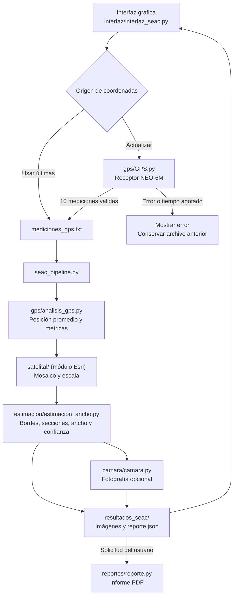

<div align="center">

<h1 id="seac">SEAC</h1>
<h3>Sistema de Estimación de Ancho de Calles</h3>

<p><strong>Estimación geométrica de vías mediante posicionamiento GPS y análisis de imágenes satelitales</strong></p>

<p><strong>Instituto Tecnológico de Costa Rica · Escuela de Ingeniería en Computadores</strong><br>
CE-1114 — Proyecto de Aplicación de la Ingeniería en Computadores · II semestre de 2026</p>

<p><strong>Desarrollador:</strong> Javier Francisco Tenorio Cervantes<br>
<strong>Contraparte institucional:</strong> Instituto Tecnológico de Costa Rica (TEC)<br>
<strong>Persona supervisora de la contraparte:</strong> Luis Alberto Chavarria Zamora<br>
<strong>Año:</strong> 2026 · <strong>Plataforma:</strong> Raspberry Pi 4 / Linux</p>

<p>
  
  
  
  
  
</p>
<p>
  
  
  
  
  
</p>

<p><strong>Prototipo funcional sujeto a validación de campo</strong></p>

<p><a href="Manuales/manual_usuario.docx">Manual de usuario</a> · <a href="Manuales/manual_inst.docx">Manual de instalación</a> · <a href="#inicio-rapido">Inicio rápido</a></p>

</div>

---

## ¿Qué es SEAC?

El **Sistema de Estimación de Ancho de Calles (SEAC)** es una aplicación que estima, en **metros**, el ancho de una vía a partir de una posición geográfica obtenida con un receptor **GPS NEO-6M** y del análisis de imágenes de **Esri World Imagery**. El procesamiento se ejecuta en una **Raspberry Pi 4** y los resultados se presentan mediante una interfaz gráfica desarrollada en **Tkinter**.

En una ejecución, SEAC puede obtener coordenadas nuevas o reutilizar las últimas registradas; construir un mosaico satelital; detectar los límites laterales de la vía; calcular un ancho aproximado y un indicador de confianza; guardar imágenes de diagnóstico y datos en JSON; y, cuando se solicita, generar un **informe PDF**. Una cámara compatible puede añadir una fotografía de auditoría.

El proyecto busca facilitar la obtención de un parámetro geométrico de la carretera que podría utilizarse **como información de apoyo para calibrar sistemas externos** de estimación de velocidad vehicular. **SEAC no incorpora detección de vehículos, no ejecuta YOLO y no calcula velocidades.**

> **Alcance:** SEAC entrega una estimación basada en imágenes satelitales, no una medición topográfica certificada. Su indicador de confianza expresa consistencia interna del algoritmo y no garantiza un error físico determinado. La fotografía de cámara documenta la escena, pero no corrige numéricamente el ancho calculado.

<a id="documentacion"></a>
## Documentación: manuales oficiales

**Antes de instalar o utilizar el sistema, se recomienda consultar los manuales incluidos en [`Manuales/`](Manuales/).** El README explica el proyecto y reúne los comandos esenciales; los manuales detallan los procedimientos paso a paso.

| Documento | Dirigido a | Contenido principal |
|:--|:--|:--|
| **[Manual de usuario](Manuales/manual_usuario.docx)** | Personas que operan SEAC | Apertura con `seacapp`, opciones de GPS, lectura de los cuatro paneles, interpretación del ancho y la confianza, fotografía de auditoría, generación de PDF y problemas habituales. |
| **[Manual de instalación y configuración](Manuales/manual_inst.docx)** | Personas encargadas de instalar o mantener SEAC | Raspberry Pi OS, alimentación, UART, cámara, dependencias Python, estructura modular, instalación del lanzador `seacapp`, SSH/X11, SSHFS, limitaciones de CPU y diagnóstico. |

Los documentos están en formato **Microsoft Word (`.docx`)** y pueden consultarse con Word o LibreOffice. Si sus nombres cambian al incorporarlos al repositorio, deben actualizarse también los enlaces de esta sección.

<a id="indice"></a>
## Índice

1. [Inicio rápido](#inicio-rapido)
2. [Características del sistema](#caracteristicas)
3. [Arquitectura y flujo de procesamiento](#arquitectura)
4. [Tecnologías y requisitos](#tecnologias)
5. [Estructura modular del repositorio](#estructura)
6. [Instalación y preparación](#instalacion)
7. [Ejecución mediante `seacapp`](#ejecucion)
8. [Uso de la interfaz gráfica](#interfaz)
9. [Adquisición y análisis GPS](#gps)
10. [Procesamiento satelital y estimación](#algoritmo)
11. [Auditoría mediante cámara](#camara)
12. [Resultados e informe PDF](#resultados)
13. [Ejecución por consola y parámetros](#consola)
14. [Acceso a resultados por SSHFS](#sshfs)
15. [Energía y rendimiento de la Raspberry Pi](#energia)
16. [Diagnóstico y solución de problemas](#diagnostico)
17. [Limitaciones, validación y mejoras futuras](#limitaciones)
18. [Mantenimiento, fuentes y créditos](#referencias)

---

<a id="inicio-rapido"></a>
## 1. Inicio rápido

Para una instalación **ya configurada**, el uso habitual consiste en conectarse desde una computadora Linux a la Raspberry Pi y ejecutar el comando **`seacapp` dentro de la sesión SSH**.

**En la computadora cliente:**

```bash
ssh -X raspberrypi@DIRECCION_IP_RPI
```

**Una vez conectado a la Raspberry Pi:**

```bash
seacapp
```

La aplicación se ejecuta en la Raspberry Pi, pero su ventana aparece en la computadora cliente gracias al reenvío **X11**. No es necesario conectar un monitor directamente a la Raspberry Pi.

Después de abrir la interfaz:

1. Seleccionar **Iniciar → Usar últimas coordenadas** si la ubicación GPS registrada sigue siendo válida; o **Iniciar → Actualizar coordenadas** si el equipo cambió de lugar.
2. Esperar a que finalice la adquisición (cuando corresponda) y el análisis satelital.
3. Revisar el ancho, la confianza y las evidencias en pantalla.
4. Presionar **Generar informe** si se necesita el PDF.
5. Consultar los archivos generados dentro de `resultados_seac/`.

> **Importante:** `seacapp` es el lanzador de la aplicación modular. Debe estar instalado en la Raspberry Pi y su sesión gráfica remota debe disponer de `DISPLAY`. La dirección IP puede cambiar según la red o la configuración DHCP.

Para instalar el sistema desde cero, continuar en [Instalación y preparación](#instalacion) o seguir el [Manual de instalación](Manuales/manual_inst.docx).

---

<a id="caracteristicas"></a>
## 2. Características del sistema

| Funcionalidad | Qué aporta |
|:--|:--|
| **Dos modos de coordenadas** | Reutilizar el último archivo GPS o adquirir 10 mediciones nuevas desde el NEO-6M. |
| **Validación de calidad GPS** | Comprobar la fijación de posición, los satélites y el HDOP antes de aceptar las mediciones. |
| **Adquisición con tiempo máximo** | Evitar esperas indefinidas cuando el receptor no consigue una posición utilizable. |
| **Protección del archivo GPS** | Conservar las coordenadas anteriores cuando una actualización falla o queda incompleta. |
| **Georreferenciación** | Descargar teselas Esri, construir un mosaico y ubicar la coordenada promedio dentro de la imagen. |
| **Visión por computadora** | Extraer bordes, identificar la dirección de la calle y evaluar parejas de límites laterales. |
| **Medición transversal** | Estimar la separación entre los bordes mediante varias secciones de análisis. |
| **Confianza y diagnóstico** | Registrar la consistencia de las mediciones y advertir posibles resultados ambiguos. |
| **Auditoría opcional** | Capturar una fotografía de la escena, con metadatos de la ejecución. |
| **Evidencias reutilizables** | Guardar imágenes intermedias y un archivo `reporte.json`. |
| **Informe bajo demanda** | Crear un PDF con las evidencias existentes, sin ejecutar de nuevo el algoritmo. |
| **Operación remota** | Acceder a la interfaz por SSH/X11 y consultar resultados mediante SSHFS. |

---

<a id="arquitectura"></a>
## 3. Arquitectura y flujo de procesamiento

La solución está organizada en **módulos Python con responsabilidades específicas**. `seac_pipeline.py` coordina el procesamiento y la interfaz (`interfaz/interfaz_seac.py`) presenta los controles y los resultados.



> El diagrama describe la organización funcional. El nombre preciso del módulo Python dentro de `satelital/` debe corresponder al archivo existente y al import definido en `seac_pipeline.py`.

### Secuencia de una estimación

1. **Coordenadas:** elegir un archivo de mediciones existente o adquirir datos nuevos con el NEO-6M.
2. **Análisis GPS:** leer las muestras y calcular una latitud y longitud representativas.
3. **Imagen satelital:** obtener teselas de Esri, formar el mosaico y determinar su resolución cartográfica aproximada.
4. **Detección geométrica:** analizar la región próxima al GPS y buscar dos límites laterales compatibles con una calle.
5. **Cálculo:** medir secciones transversales, filtrar inconsistencias y estimar el ancho en metros junto con su confianza.
6. **Auditoría:** intentar obtener una fotografía, si la captura está habilitada.
7. **Registro:** generar imágenes de análisis y `reporte.json`; mostrar el resultado en la GUI.
8. **Informe (opcional):** construir el PDF a partir de los archivos existentes.

La captura fotográfica es **complementaria**: si la cámara no responde, el cálculo satelital puede terminar y registrar la ausencia de esa evidencia.

---

<a id="tecnologias"></a>
## 4. Tecnologías y requisitos

### 4.1. Hardware

| Componente | Función en SEAC |
|:--|:--|
| **Raspberry Pi 4** | Ejecuta Python, procesa las imágenes y administra GPS, cámara y resultados. |
| **NEO-6M con antena GPS** | Envía sentencias NMEA por la interfaz serial UART. |
| **Cámara compatible con OpenCV** | Permite registrar una fotografía de auditoría, cuando está disponible. |
| **Alimentación estable** | Mantiene la Raspberry Pi operativa durante descargas y procesamiento intensivo. |
| **Red e Internet** | SSH/X11 desde el cliente y acceso al servicio de imágenes satelitales. |
| **Computadora Linux con entorno gráfico** | Muestra la interfaz mediante X11 y puede montar los resultados con SSHFS. |

**Conexión UART habitual:** TX del módulo GPS hacia RX de la Raspberry Pi (GPIO15, pin físico 10), con GND compartido. Si se requiere comunicación en sentido contrario, TX de la Raspberry (GPIO14, pin físico 8) hacia RX del GPS. Es indispensable respetar los niveles lógicos y el voltaje especificado por la placa GPS utilizada; los GPIO de la Raspberry Pi trabajan con lógica de **3,3 V**.

### 4.2. Software

| Tecnología | Responsabilidad |
|:--|:--|
| **Python 3** | Lenguaje de implementación del proyecto. |
| **Raspberry Pi OS / Linux** | Sistema operativo y acceso a dispositivos. |
| **OpenCV** | Visión por computadora, detección de bordes y captura de cámara. |
| **NumPy** | Cálculo numérico y tratamiento de arrays. |
| **Pillow** | Manipulación y visualización de imágenes. |
| **Tkinter / ttk** | Interfaz gráfica de escritorio. |
| **pyserial y pynmea2** | Comunicación serial y análisis de mensajes NMEA del GPS. |
| **ReportLab** | Generación del informe PDF. |
| **Esri World Imagery** | Servicio externo de imágenes satelitales. |
| **OpenSSH / X11** | Ejecución remota de la interfaz gráfica. |
| **SSHFS / FUSE** | Montaje remoto de la carpeta de resultados. |
| **`v4l2-ctl`** | Configuración de ciertos controles de cámara en Linux, cuando se admiten. |

Las herramientas de procesamiento intensivo pueden consumir recursos considerables. La configuración del lanzador limita la afinidad de CPU y algunos hilos de bibliotecas numéricas, pero **no elimina los requisitos de alimentación eléctrica**.

---

<a id="estructura"></a>
## 5. Estructura modular del repositorio

La aplicación se ejecuta desde la **raíz del proyecto**, donde permanece `seac_pipeline.py`. Los demás componentes se agrupan en paquetes con su correspondiente `__init__.py`.

```text
SEAC_Project/
├── README.md
├── Manuales/
│   ├── manual_usuario.docx           # Guía de operación
│   └── manual_inst.docx              # Instalación y configuración
├── camara/
│   ├── __init__.py
│   └── camara.py                     # Captura y auditoría visual
├── estimacion/
│   ├── __init__.py
│   └── estimacion_ancho.py           # Estimación geométrica
├── gps/
│   ├── __init__.py
│   ├── GPS.py                        # Adquisición NEO-6M
│   └── analisis_gps.py               # Estadística y ubicación promedio
├── interfaz/
│   ├── __init__.py
│   ├── acerca_de.py                  # Ventana informativa
│   └── interfaz_seac.py              # GUI Tkinter
├── reportes/
│   ├── __init__.py
│   └── reporte.py                    # Creación de PDF
├── satelital/
│   ├── __init__.py
│   └── ...                           # Descarga y georreferenciación Esri
├── seac_pipeline.py                  # Coordinador de las etapas
├── mediciones_gps.txt                # Últimas lecturas GPS válidas
├── resultados_seac/                  # Evidencias generadas
└── .venv/                            # Entorno virtual local (si se utiliza)
```

**Notas de organización:**

- `gps/GPS.py` **adquiere** mediciones del dispositivo; `gps/analisis_gps.py` **procesa** mediciones ya registradas. No son intercambiables.
- `interfaz/interfaz_seac.py` presenta resultados; no debe duplicar el algoritmo del pipeline.
- `reportes/reporte.py` genera el PDF usando un análisis ya completado; no realiza una nueva medición.
- En `satelital/`, el nombre del archivo debe coincidir con el import real de `seac_pipeline.py` (por ejemplo, `imagenes_esri.py` si ese es el nombre utilizado).
- Carpetas adicionales de recursos, pruebas o mediciones pueden existir según el despliegue. No deben confundirse con los módulos de ejecución.

**Regla fundamental para ejecutar Python:** utilizar `python3 -m interfaz.interfaz_seac` **desde la raíz**, no `python3 interfaz_seac.py` dentro de `interfaz/`. De esta forma Python reconoce los paquetes y se evita el error `attempted relative import with no known parent package`.

---

<a id="instalacion"></a>
## 6. Instalación y preparación

Las siguientes instrucciones resumen el despliegue utilizado en la Raspberry Pi. Para cableado, paquetes, seguridad, SSH/X11 y validación detallada, consultar el **[Manual de instalación](Manuales/manual_inst.docx)**.

### 6.1. Preparar Raspberry Pi OS

```bash
sudo apt update
sudo apt install -y \
  python3 python3-pip python3-venv python3-tk \
  python3-numpy python3-opencv python3-pil python3-pil.imagetk \
  python3-reportlab openssh-server xauth v4l-utils \
  util-linux

sudo systemctl enable --now ssh
```

Los nombres y la disponibilidad de algunos paquetes pueden variar entre versiones de Raspberry Pi OS. Verificar el paquete concreto si `apt` indica que no está disponible.

### 6.2. Configurar la comunicación GPS

```bash
sudo raspi-config
```

En **Interface Options → Serial Port**: desactivar el inicio de sesión por consola serial y habilitar el hardware serial. Después, reiniciar y verificar el puerto:

```bash
ls -l /dev/serial0
ls -l /dev/serial*
groups
```

El código de adquisición documentado utiliza **`/dev/serial0` a 9600 baudios**. El usuario que ejecute SEAC debe tener acceso al puerto; cuando corresponda, revisar el grupo `dialout`. **No** es recomendable abrir permisos indiscriminados ni ejecutar toda la aplicación como `root`.

### 6.3. Copiar el proyecto a la Raspberry Pi

Copiar todas las carpetas del repositorio, incluidos `Manuales/` y los módulos Python. Si el proyecto se encuentra en `~/Documentos/SEAC_Project` de la laptop, una opción es utilizar **`rsync`** desde esa computadora:

```bash
ssh raspberrypi@DIRECCION_IP_RPI \
  'mkdir -p /home/raspberrypi/Downloads/SEAC_Project_prueba'

rsync -avh --progress \
  --exclude='.venv/' --exclude='__pycache__/' \
  --exclude='.git/' --exclude='resultados_seac/' \
  "$HOME/Documentos/SEAC_Project/" \
  raspberrypi@DIRECCION_IP_RPI:/home/raspberrypi/Downloads/SEAC_Project_prueba/
```

La carpeta de destino es la utilizada en el despliegue documentado. Ajustar tanto las rutas como el usuario y la IP en una instalación diferente. **No copiar el entorno virtual de una arquitectura de CPU distinta**: conviene crear el entorno en la propia Raspberry Pi.

### 6.4. Preparar las bibliotecas Python

Situarse en la raíz donde se haya copiado el proyecto. En el despliegue documentado se utiliza:

```bash
cd /home/raspberrypi/Downloads/SEAC_Project_prueba
```

La ruta conserva ese nombre en la instalación conocida; **el sistema que contiene es la versión modular del SEAC**. Puede trasladarse a otro directorio siempre que se actualice el lanzador y el montaje de resultados.

Si las dependencias aún no están configuradas, crear un entorno virtual con acceso a los paquetes del sistema:

```bash
python3 -m venv --system-site-packages .venv
source .venv/bin/activate
python -m pip install pynmea2 pyserial
```

Comprobar los imports **con el mismo intérprete que utilizará el lanzador**:

```bash
python -c "import cv2, numpy, PIL, reportlab, tkinter, serial, pynmea2; print('Dependencias SEAC correctas')"
```

Si no se utiliza `.venv`, comprobarlos con `python3`. En Raspberry Pi OS moderno es preferible evitar instalar paquetes con `pip` directamente sobre el Python administrado por el sistema.

### 6.5. Verificar paquetes e interfaz

```bash
cd /home/raspberrypi/Downloads/SEAC_Project_prueba
python3 -m interfaz.interfaz_seac --help
python3 seac_pipeline.py --help
```

Si se está utilizando `.venv`, sustituir `python3` por `.venv/bin/python3` en ambas instrucciones. Los dos comandos anteriores muestran argumentos y **no requieren abrir la interfaz**.

---

<a id="ejecucion"></a>
## 7. Ejecución mediante `seacapp`

### 7.1. ¿Qué hace el lanzador?

`seacapp` es un script instalado en la Raspberry Pi, normalmente en **`/usr/local/bin/seacapp`**. Se encarga de:

1. Entrar en la raíz de la aplicación modular.
2. Restringir ciertos hilos de cálculo numérico.
3. Limitar la afinidad del proceso y de sus subprocesos a los núcleos lógicos **0 y 1**.
4. Elegir Python del entorno `.venv` si existe, o `python3` del sistema.
5. Iniciar la aplicación como **módulo Python**, manteniendo funcionales los imports de paquetes.

**Contenido recomendado del lanzador:**

```bash
#!/usr/bin/env bash
set -euo pipefail

cd /home/raspberrypi/Downloads/SEAC_Project_prueba

export OMP_NUM_THREADS=1
export OPENBLAS_NUM_THREADS=1
export MKL_NUM_THREADS=1

PYTHON=python3
if [[ -x .venv/bin/python3 ]]; then
    PYTHON=.venv/bin/python3
fi

exec taskset -c 0,1 "$PYTHON" -m interfaz.interfaz_seac
```

Para crearlo en una instalación nueva:

```bash
sudo nano /usr/local/bin/seacapp
# Pegar el script anterior y guardar.
sudo chmod +x /usr/local/bin/seacapp
command -v seacapp
```

La reducción de frecuencia de la Raspberry Pi a **1 GHz no forma parte de este script**: es una configuración independiente que afecta al equipo completo. Ver [Energía y rendimiento](#energia).

### 7.2. Abrir la aplicación desde la laptop

**En la laptop Linux:**

```bash
ssh -X raspberrypi@DIRECCION_IP_RPI
```

**Dentro de la Raspberry Pi:**

```bash
seacapp
```

La ventana Tkinter aparece en la laptop. El GPS, el procesamiento de imágenes y la generación de archivos se realizan físicamente en la Raspberry Pi. La terminal de SSH debe permanecer abierta mientras se utiliza la aplicación.

También es posible ejecutar desde la laptop, en una sola instrucción, el lanzador ya instalado en la Raspberry:

```bash
ssh -X -t raspberrypi@DIRECCION_IP_RPI 'seacapp'
```

Este último comando **no monta automáticamente SSHFS**: la consulta de archivos por montaje remoto se explica por separado en [Acceso a resultados por SSHFS](#sshfs).

### 7.3. Ejecución directa para mantenimiento

Desde la **raíz del proyecto**, cuando se necesite diagnosticar el sistema sin el lanzador:

```bash
python3 -m interfaz.interfaz_seac
```

Si se utiliza un entorno virtual, usar `.venv/bin/python3`. Esta ejecución directa **no aplica automáticamente** las restricciones de afinidad o hilos que incorpora `seacapp`.

---

<a id="interfaz"></a>
## 8. Uso de la interfaz gráfica

La ventana principal está dividida en cuatro paneles de información y una columna de acciones.

| Zona | Información o función |
|:--|:--|
| **Panel 1: Ubicación y métricas** | Mediciones válidas, latitud y longitud promedio, dispersión GPS, resolución cartográfica y métricas adicionales disponibles. |
| **Panel 2: Imagen satelital** | Mosaico con el marcador de ubicación GPS. |
| **Panel 3: Imagen de cámara** | Fotografía de auditoría y botón para ampliarla, cuando se obtuvo correctamente. |
| **Panel 4: Resultado** | Ancho estimado, confianza, orientación y cantidad de secciones transversales válidas. |
| **Barra de estado** | Mensajes sobre la adquisición, el procesamiento, la generación del PDF o los errores. |

### Controles principales

| Control | Acción |
|:--|:--|
| **Iniciar → Usar últimas coordenadas** | Procesa `mediciones_gps.txt` sin realizar una lectura nueva del NEO-6M. |
| **Iniciar → Actualizar coordenadas** | Ejecuta el módulo GPS, valida la adquisición y, solo si termina correctamente, comienza el pipeline. |
| **Análisis satelital** | Abre la visualización ampliada de las secciones transversales, si el archivo existe. |
| **Ampliar foto de auditoría** | Muestra la fotografía guardada a mayor tamaño. |
| **Generar informe** | Crea el PDF a partir del resultado existente. |
| **Reiniciar** | Limpia la información en pantalla; **no elimina** archivos guardados. |
| **Acerca de** | Presenta información del proyecto. |
| **Salir** | Cierra la aplicación gráfica. |

**Cuándo actualizar coordenadas:** si la Raspberry Pi se movió a otra calle o cambió la ubicación de la medición. La opción **Usar últimas coordenadas** sirve para repetir un análisis sin consultar nuevamente al receptor GPS, pero puede producir un resultado para una ubicación anterior.

La interfaz ejecuta tareas prolongadas en hilos de trabajo para evitar bloquear la ventana y deshabilita temporalmente controles mientras se procesa una operación.

---

<a id="gps"></a>
## 9. Adquisición y análisis GPS

### 9.1. Adquisición con NEO-6M

El módulo `gps/GPS.py` abre **`/dev/serial0` a 9600 baudios** y lee sentencias NMEA de tipo **GGA** (`$GPGGA` o `$GNGGA`). Para aceptar una lectura, exige:

| Criterio | Condición documentada |
|:--|:--|
| Estado GPS | Posición válida (*GPS Fix*) |
| Satélites utilizados | **5 o más** |
| HDOP | **2,0 o menor** |
| Separación entre mediciones aceptadas | **2 segundos** como mínimo |
| Cantidad objetivo | **10 mediciones** |
| Tiempo para encontrar la primera muestra válida | **60 segundos** |
| Tiempo adicional para completar el conjunto | **60 segundos** |

El archivo generado tiene el formato:

```text
GPS,indice,latitud,longitud,satelites,HDOP
```

Cada línea es un registro de datos, por ejemplo:

```text
GPS,1,9.86400000,-83.91500000,8,1.20
```

**Los valores del ejemplo son ilustrativos y no representan una lectura real.**

### 9.2. Si no se obtiene señal válida

El programa no espera indefinidamente. Si transcurren 60 segundos sin una primera medición que cumpla las condiciones, muestra un error y recomienda esperar un minuto antes de reintentar. Si se obtiene una muestra válida pero no se completan las diez dentro del tiempo adicional, también detiene la adquisición.

**Protección de datos:** las diez muestras se almacenan temporalmente y `mediciones_gps.txt` **solo se reemplaza al completar la adquisición**. El guardado se realiza mediante un archivo temporal y una sustitución atómica. Por ello, una adquisición fallida no debería borrar las últimas coordenadas válidas.

La interfaz incorpora además un **límite de 135 segundos** para el subproceso GPS, como margen de seguridad ante bloqueos inesperados. Si falla la actualización, no inicia una estimación nueva y vuelve a permitir el uso de **Iniciar**.

### 9.3. Interpretar las sentencias NMEA

Una sentencia como:

```text
$GPGGA,,,,,,0,00,99.99,,,,,,*48
```

indica que **no se dispone de un posicionamiento válido**, con cero satélites utilizados y un HDOP no utilizable. La recepción de texto NMEA confirma comunicación serial, pero **no significa que el receptor ya tenga GPS Fix**.

Para observar la salida serial directamente en la Raspberry Pi, con SEAC y otros lectores del puerto cerrados:

```bash
stty -F /dev/serial0 9600 raw -echo
cat /dev/serial0
```

Detener con `Ctrl + C`. La antena debe contar con una vista despejada del cielo y el receptor puede necesitar varios minutos para adquirir satélites dependiendo de las condiciones.

### 9.4. Estadísticas del archivo GPS

El módulo `gps/analisis_gps.py` convierte las diez muestras en una ubicación representativa mediante el cálculo de **latitud y longitud promedio**. También puede calcular cantidad de registros, dispersión espacial, distancias al punto promedio y métricas adicionales de satélites y HDOP.

El promedio GPS no necesariamente coincide con el centro de la calle: el equipo puede estar situado sobre una acera o cerca de un borde. Esta diferencia afecta la región de búsqueda del algoritmo y debe considerarse al interpretar el resultado.

---

<a id="algoritmo"></a>
## 10. Procesamiento satelital y estimación del ancho

### 10.1. Obtener el mosaico georreferenciado

A partir de las coordenadas promedio, el componente satelital convierte la ubicación a la cuadrícula **Web Mercator**, identifica las teselas de **Esri World Imagery** y compone una imagen de referencia.

La configuración documentada en el README anterior contempla un **zoom de 19**, un **radio de una tesela** y un mosaico de **3 × 3 teselas de 256 × 256 píxeles**, equivalente a una imagen de **768 × 768 píxeles**. Los valores efectivos deben corroborarse con `python3 seac_pipeline.py --help` de la instalación.

Se obtiene además una **resolución cartográfica aproximada en metros por píxel**, utilizada para convertir separaciones observadas en la imagen a unidades físicas:

```text
Ancho estimado (m) = separación transversal (px) × resolución (m/px)
```

La imagen utilizada para procesar los bordes no incorpora el marcador gráfico del GPS, para evitar que ese símbolo genere contornos artificiales.

### 10.2. Identificar los bordes de la calle

El módulo `estimacion/estimacion_ancho.py` busca dos límites laterales que correspondan a la **misma vía**, no simplemente las dos líneas más intensas de la fotografía. De forma resumida:

1. Delimita una **región de interés (ROI)** alrededor del punto GPS.
2. Genera una **máscara aproximada de superficies compatibles con asfalto** mediante información de color, brillo y textura.
3. Analiza intensidades de gris y calcula bordes con **Canny**.
4. Extrae segmentos lineales mediante **HoughLinesP** y estima la orientación predominante de la calle.
5. Evalúa parejas de segmentos candidatas, según ancho plausible, paralelismo, continuidad, cercanía al GPS y coherencia visual.
6. Puede repetir la búsqueda con una ROI menor si el resultado inicial es poco confiable.
7. Mide varias secciones transversales guiadas por la pareja de bordes seleccionada.
8. Filtra medidas inconsistentes y entrega un ancho estimado junto con métricas de confianza.

La máscara de asfalto **no es una segmentación perfecta**. Superficies de concreto, estacionamientos, sombras y aceras pueden presentar características parecidas a las de una calzada.

### 10.3. Secciones, reintentos y confianza

El algoritmo documentado utiliza **13 secciones transversales candidatas**, ubicadas aproximadamente entre −6 m y +6 m a lo largo de la dirección de la calle. Rechaza secciones inconsistentes y emplea una estadística robusta, basada en la mediana, para obtener el ancho final. El comportamiento descrito exige un mínimo de **tres secciones consistentes**.

Cuando no encuentra una pareja suficientemente confiable, puede realizar un segundo intento con una región de interés reducida. Los parámetros históricos del proyecto contemplan un umbral de reintento de **0,45**, una reducción al **60 %** del ROI y un mínimo de **8 m**; estos valores deben cotejarse con el código desplegado.

La confianza considera consistencia de ancho, cobertura de secciones, orientación y calidad geométrica de los bordes seleccionados. El resultado puede incluir etiquetas cualitativas como **Alta**, **Media**, **Baja** o **Insuficiente**, y datos de diagnóstico como `motivo_fallo_pareja`, `roi_candidatos` o `roi_ambiguo`.

> **Lectura correcta:** un valor de confianza elevado indica que los criterios internos del algoritmo coincidieron favorablemente. **No significa que la medida tenga ese mismo porcentaje de precisión real.**

---

<a id="camara"></a>
## 11. Auditoría mediante cámara

Cuando la cámara está conectada y la captura está habilitada, `camara/camara.py` intenta registrar una fotografía de referencia. Puede añadir una banda informativa que contiene **fecha y hora, coordenadas promedio asociadas a la ejecución y ancho satelital calculado**, siempre que esos datos existan.

El módulo utiliza **OpenCV** y puede interactuar con controles compatibles mediante **V4L2** (`v4l2-ctl`), por ejemplo para la exposición. La disponibilidad de controles y los resultados dependen de la cámara conectada.

La fotografía cumple una función de **auditoría visual**, no de medición geométrica. Si falla su captura, el reporte puede registrar `camara.disponible = false` y un motivo, sin invalidar por sí mismo la estimación satelital.

Las coordenadas impresas en la fotografía corresponden al análisis GPS asociado a la ejecución; no son una nueva lectura tomada exactamente en el instante de disparar la cámara.

---

<a id="resultados"></a>
## 12. Resultados e informe PDF

### 12.1. Archivos generados

Las evidencias se guardan, de forma predeterminada, en `resultados_seac/`, dentro de la raíz desde la cual se ejecuta el pipeline.

```text
resultados_seac/
├── 01_imagen_satelital.png          # Mosaico original
├── 02_imagen_con_gps.png           # Ubicación GPS marcada
├── 03_contraste_grises.png         # Imagen base de contraste
├── 04_mascara_asfalto.png          # Superficies candidatas
├── 05_bordes_canny.png            # Bordes detectados
├── 06_secciones_transversales.png  # Bordes y mediciones seleccionadas
├── camara_referencia_...jpg        # Opcional: evidencia fotográfica
├── reporte.json                   # Resultados y diagnóstico estructurado
└── SEAC_reporte_...pdf             # Solo si el usuario solicita el informe
```

**Precaución:** el conjunto exacto de archivos puede depender de la configuración y de las etapas completadas. La función **Reiniciar** limpia la interfaz, pero **no elimina** los archivos del disco. Si se requiere historial, conviene respaldar ejecuciones previas antes de repetir análisis que puedan reutilizar nombres de salida.

### 12.2. Estructura del JSON

El archivo `reporte.json` puede contener, entre otros, los siguientes campos:

| Campo | Contenido |
|:--|:--|
| `analisis_gps` | Promedio de coordenadas, cantidad de mediciones y estadísticas de posición. |
| `resolucion_cartografica_m_por_pixel` | Relación utilizada para convertir píxeles a metros. |
| `deteccion.ancho_preliminar_m` | Ancho estimado, cuando se obtuvo una solución. |
| `deteccion.confianza` | Indicador numérico interno de calidad. |
| `deteccion.nivel_confianza` | Categoría cualitativa de confianza. |
| `deteccion.angulo_calle_grados` | Orientación principal identificada. |
| `deteccion.cantidad_secciones_validas` | Cantidad de cortes transversales aceptados. |
| `deteccion.cantidad_secciones_candidatas` | Cantidad total de cortes evaluados. |
| `deteccion.pareja_global` | Información sobre los límites de vía elegidos, si se registra. |
| `deteccion.motivo_fallo_pareja` | Diagnóstico de selección fallida, cuando aplica. |
| `camara` | Estado, ruta de fotografía o motivo de ausencia. |
| `estado_pdf` / `reporte_pdf` | Estado y ruta del informe cuando se genera mediante la GUI. |

Ejemplo parcial con **datos ficticios**:

```json
{
  "analisis_gps": {
    "cantidad_mediciones": 10,
    "latitud_promedio": 9.864,
    "longitud_promedio": -83.915
  },
  "deteccion": {
    "ancho_preliminar_m": 6.5,
    "confianza": 0.82,
    "nivel_confianza": "Alta",
    "cantidad_secciones_validas": 10,
    "cantidad_secciones_candidatas": 13
  },
  "camara": {
    "disponible": false,
    "motivo": "captura_deshabilitada"
  }
}
```

### 12.3. Informe PDF

El informe **no se genera automáticamente** al terminar el cálculo. Para crearlo:

1. Completar una estimación.
2. Presionar **Generar informe**.
3. Esperar a que aparezca la confirmación.
4. Elegir **Ver informe**, o cerrar el diálogo para conservar el archivo.

El formato documentado es de **tres páginas A4**: resultado y métricas GPS; evidencia satelital y análisis transversal; y fotografía de auditoría (si está disponible), con observaciones y atribuciones. El PDF se construye a partir de las evidencias existentes: **no vuelve a leer el GPS ni a ejecutar el algoritmo**.

Para instrucciones paso a paso sobre la interfaz y la consulta del informe, revisar el **[Manual de usuario](Manuales/manual_usuario.docx)**.

---

<a id="consola"></a>
## 13. Ejecución por consola y parámetros

Además de la GUI, es posible ejecutar el coordinador directamente desde la raíz del proyecto:

```bash
cd /home/raspberrypi/Downloads/SEAC_Project_prueba
python3 seac_pipeline.py mediciones_gps.txt
```

Ejemplo con algunos límites explícitos:

```bash
python3 seac_pipeline.py mediciones_gps.txt \
  --roi-metros 20 \
  --ancho-minimo-m 3 \
  --ancho-maximo-m 10
```

También puede ejecutarse la adquisición independiente, **siempre desde la raíz** para que `mediciones_gps.txt` se escriba en esa ubicación:

```bash
python3 gps/GPS.py
```

En una instalación con `.venv`, usar `.venv/bin/python3` si las bibliotecas GPS están disponibles allí.

### Parámetros habituales del pipeline

La siguiente tabla recoge opciones documentadas en el README anterior. **Verificar los valores vigentes en la versión instalada mediante `python3 seac_pipeline.py --help`** antes de cambiar la configuración.

| Argumento | Valor documentado | Propósito |
|:--|:--|:--|
| `archivo` | `mediciones_gps.txt` | Archivo de coordenadas de entrada. |
| `--zoom` | `19` | Nivel de zoom de Esri. |
| `--radio-teselas` | `1` | Radio del mosaico; `1` produce 3 × 3 teselas. |
| `--salida` | `resultados_seac` | Carpeta de salida. |
| `--roi-metros` | `20.0` | Radio de análisis alrededor de la ubicación GPS. |
| `--ancho-minimo-m` / `--ancho-maximo-m` | `3.0` / `12.0` | Rango de anchuras admisibles. |
| `--longitud-minima-m` | `4.0` | Longitud mínima de los segmentos. |
| `--tolerancia-angulo` | `12.0` | Tolerancia angular en grados. |
| `--canny-bajo` / `--canny-alto` | Automático | Umbrales de Canny. |
| `--saturacion-maxima` | `90` | Filtro de saturación para superficies candidatas. |
| `--textura-maxima` | `1000.0` | Umbral de textura local. |
| `--confianza-minima-reintento` | `0.45` | Umbral para explorar otra ROI. |
| `--mostrar` | Desactivado | Solicita visualizaciones al ejecutar desde consola. |

La interfaz comparte el analizador de argumentos del pipeline, pero desactiva internamente la opción de visualización externa (`mostrar`) para gestionar sus propias ventanas.

---

<a id="sshfs"></a>
## 14. Acceso a resultados por SSHFS

La carpeta de resultados puede consultarse desde la laptop sin copiar manualmente los archivos después de cada ejecución. Esto es **independiente** de iniciar la interfaz mediante `seacapp`.

**En la laptop Linux**, instalar SSHFS si no está disponible:

```bash
sudo apt install sshfs
mkdir -p ~/rpi_remota
```

Montar los resultados del despliegue modular:

```bash
sshfs \
  raspberrypi@DIRECCION_IP_RPI:/home/raspberrypi/Downloads/SEAC_Project_prueba/resultados_seac \
  ~/rpi_remota -o ro,reconnect
```

La opción `ro` configura el montaje **en modo de solo lectura**. Para consultar:

```bash
ls -lah ~/rpi_remota
xdg-open ~/rpi_remota
```

Para desmontar desde la laptop:

```bash
fusermount3 -u ~/rpi_remota
```

Si la Raspberry Pi se apaga o cambia de dirección IP, un montaje FUSE puede quedar obsoleto y producir `Input/output error`. En ese caso:

```bash
fusermount3 -uz ~/rpi_remota
mkdir -p ~/rpi_remota
# Repetir el comando sshfs con la dirección IP vigente.
```

Algunas distribuciones utilizan `fusermount` en lugar de `fusermount3`. El parámetro `reconnect` intenta restablecer una sesión interrumpida, pero **no descubre por sí solo una IP nueva**.

---

<a id="energia"></a>
## 15. Energía y rendimiento de la Raspberry Pi

El procesamiento de imágenes puede incrementar temporalmente la carga de la CPU. En pruebas del despliegue se recurrió a una **afinidad de dos núcleos** y a un límite de **un hilo** para determinadas bibliotecas numéricas con el objetivo de moderar el consumo.

### 15.1. Restricciones incluidas en `seacapp`

```bash
export OMP_NUM_THREADS=1
export OPENBLAS_NUM_THREADS=1
export MKL_NUM_THREADS=1

taskset -c 0,1 python3 -m interfaz.interfaz_seac
```

Estas variables solo limitan bibliotecas que las respetan. `taskset -c 0,1` restringe la **afinidad**, pero no deshabilita físicamente los otros núcleos ni garantiza un valor fijo de potencia.

### 15.2. Comprobar la frecuencia máxima

```bash
cat /sys/devices/system/cpu/cpufreq/policy0/scaling_max_freq
```

Si responde `1000000`, el máximo configurado es **1 GHz** (el valor se expresa en kHz). El límite puede aplicarse de manera temporal con:

```bash
echo 1000000 | sudo tee /sys/devices/system/cpu/cpufreq/policy0/scaling_max_freq
```

Esta configuración **afecta a todo el equipo**, no solo al SEAC, y puede perderse tras reiniciar. Para recuperar el máximo permitido por el sistema:

```bash
cat /sys/devices/system/cpu/cpufreq/policy0/cpuinfo_max_freq | \
  sudo tee /sys/devices/system/cpu/cpufreq/policy0/scaling_max_freq
```

### 15.3. Diagnóstico de bajo voltaje

```bash
vcgencmd get_throttled
```

| Ejemplo | Interpretación |
|:--|:--|
| `throttled=0x0` | No se registran las condiciones indicadas por estas banderas desde el arranque. |
| `throttled=0x1` | Bajo voltaje detectado en ese momento. |
| `throttled=0x10000` | Se detectó bajo voltaje anteriormente desde el arranque. |
| `throttled=0x50000` | Se registraron bajo voltaje y limitación de rendimiento anteriormente; las banderas actuales no están activas. |

Para observar temperatura, frecuencia real y estado eléctrico:

```bash
watch -n 2 'vcgencmd measure_temp; vcgencmd measure_clock arm; vcgencmd get_throttled'
```

**Una batería externa de 5 V / 2 A puede resultar insuficiente** para una Raspberry Pi 4 con periféricos y procesamiento intensivo. Para operación estable se recomienda una alimentación adecuada, de referencia **5,1 V / 3 A**, con cable de calidad y sin caídas excesivas de voltaje. Las restricciones de CPU son medidas de mitigación: **no reemplazan una alimentación correcta**.

Evitar cortar la alimentación mientras el sistema escribe archivos. Para apagarlo con seguridad:

```bash
sudo poweroff
```

---

<a id="diagnostico"></a>
## 16. Diagnóstico y solución de problemas

| Situación | Posible causa y acción recomendada |
|:--|:--|
| `seacapp: command not found` | Comprobar `command -v seacapp`, existencia de `/usr/local/bin/seacapp`, permisos de ejecución y `PATH`. |
| No aparece la ventana gráfica | Conectar con `ssh -X`, revisar `echo "$DISPLAY"`, `xauth` y el servidor gráfico de la laptop. |
| `ModuleNotFoundError` | Revisar el intérprete seleccionado por `seacapp` y las dependencias instaladas en ese entorno. |
| `attempted relative import with no known parent package` | Ejecutar la interfaz con `python3 -m interfaz.interfaz_seac` desde la raíz del proyecto. |
| `No module named 'satelital....'` | Verificar el nombre real del archivo en `satelital/`, el `__init__.py` y los imports de `seac_pipeline.py`. |
| No se encuentra `gps/GPS.py` | Comprobar la estructura modular y que la interfaz calcule la raíz del proyecto correctamente. |
| `Permission denied` al abrir `/dev/serial0` | Revisar `ls -l /dev/serial0`, la configuración de UART y la pertenencia al grupo `dialout`. |
| Se reciben NMEA, pero no hay GPS Fix | Llevar la antena a un sitio con vista despejada del cielo y esperar la adquisición; revisar GGA, satélites y HDOP. |
| GPS no consigue 10 muestras | La adquisición debe terminar por tiempo máximo y mantener el archivo de coordenadas anterior; reintentar después de revisar la señal. |
| Imagen satelital no disponible | Comprobar Internet, DNS, disponibilidad de Esri, zoom y restricciones de acceso. |
| Ancho no estimado o confianza baja | Inspeccionar `06_secciones_transversales.png`, las parejas de bordes, la ROI y los diagnósticos del JSON. |
| No hay fotografía de cámara | Revisar `/dev/video*`, `v4l2-ctl`, permisos, iluminación y el estado `camara` de `reporte.json`. |
| El botón **Generar informe** está deshabilitado | Completar primero una estimación que genere `reporte.json`. |
| El PDF existe, pero no abre desde la GUI | Consultar directamente el archivo en `resultados_seac/` o desde el montaje SSHFS. |
| `fuse: ... Input/output error` | Desmontar el montaje obsoleto con `fusermount3 -uz` y montar nuevamente con la IP correcta. |
| SSH deja de funcionar tras un reinicio | Verificar la IP con `hostname -I` cuando haya acceso local y confirmar que SSH esté activo. |
| La Raspberry Pi se apaga al procesar | Revisar alimentación, cable y `vcgencmd get_throttled`; no depender exclusivamente de límites de CPU. |

Para guías más detalladas, consultar el **[Manual de instalación](Manuales/manual_inst.docx)** y el **[Manual de usuario](Manuales/manual_usuario.docx)**.

---

<a id="limitaciones"></a>
## 17. Limitaciones, validación y mejoras futuras

### 17.1. Limitaciones actuales

- **Precisión GPS:** una posición aceptada puede mantener cierto desplazamiento respecto al punto real o respecto al centro de la vía.
- **Imágenes satelitales:** su fecha, resolución nativa, geometría, sombras y posibles oclusiones influyen en el análisis.
- **Superficies similares:** aceras, estacionamientos y ciertas texturas pueden confundirse con límites viales.
- **Entornos complejos:** intersecciones, curvas, vías irregulares y líneas parciales pueden generar ambigüedad.
- **Servicio externo:** la descarga de nuevos mosaicos necesita acceso al proveedor satelital.
- **Auditoría visual:** la cámara documenta la escena, pero no modifica el cálculo numérico actual.
- **Alcance funcional:** el sistema no calcula velocidades vehiculares ni sustituye equipos profesionales de medición topográfica.

### 17.2. Metas de evaluación, no resultados certificados

La documentación académica del proyecto contempla como objetivos de evaluación un rango de vías de aproximadamente **2,5 a 20 m**, un error relativo deseado **menor o igual al 15 %** y un tiempo de estimación objetivo de **20 segundos o menos**. Estos valores **no deben presentarse como resultados universalmente alcanzados** sin ensayos de campo y medidas de referencia.

El tiempo necesario para conseguir señal GPS puede exceder el tiempo del procesamiento satelital y se analiza por separado. Del mismo modo, la confianza interna del algoritmo **no equivale** al error relativo frente a una medición física.

### 17.3. Posibles extensiones

Entre las líneas de trabajo futuras se encuentran ampliar la validación sobre carreteras de diferentes materiales, mejorar la separación entre acera y calzada, estudiar más escenarios con sombras e intersecciones, contrastar estimaciones con medidas físicas y evaluar técnicas adicionales de segmentación visual.

Se presentan como **posibilidades de investigación y mejora**, no como funcionalidades ya implementadas.

---

<a id="referencias"></a>
## 18. Mantenimiento, fuentes y créditos

### Mantenimiento básico

- Mantener respaldos de `mediciones_gps.txt`, `reporte.json` y evidencias que se necesiten conservar.
- Si cambia el directorio del proyecto, actualizar el `cd` de `/usr/local/bin/seacapp` y la ruta remota utilizada por SSHFS.
- Si cambia la IP de la Raspberry Pi, utilizar la nueva dirección en SSH/SSHFS o configurar una reserva DHCP en el router.
- Revisar periódicamente dependencias, permisos del puerto serial y estado de alimentación.
- Registrar las pruebas de campo y contrastar las estimaciones con medidas de referencia antes de utilizarlas en decisiones críticas.
- Apagar la Raspberry Pi ordenadamente con `sudo poweroff` antes de retirar la energía.

### Fuentes y atribuciones

- **[Esri World Imagery](https://www.esri.com/en-us/arcgis/products/arcgis-online/resources):** origen de las imágenes satelitales. La atribución específica de las imágenes puede corresponder también a otros proveedores; comprobar las condiciones de uso y los créditos requeridos antes de redistribuir capturas o informes.
- **[Raspberry Pi Documentation](https://www.raspberrypi.com/documentation/computers/):** documentación del hardware, UART, alimentación, sistema operativo y acceso remoto.
- **[Python](https://docs.python.org/3/)**, **[OpenCV](https://docs.opencv.org/)**, **[NumPy](https://numpy.org/doc/)** y **[ReportLab](https://docs.reportlab.com/)**: documentación de las herramientas utilizadas.
- **Documentación académica SEAC (TEC, 2026):** ficha del proyecto, documento de requerimientos, diseño, plan de proyecto y los manuales incluidos en [`Manuales/`](Manuales/).

### Identificación académica

| Campo | Información |
|:--|:--|
| Proyecto | Sistema de Estimación de Ancho de Calles — SEAC |
| Desarrollador | Javier Francisco Tenorio Cervantes |
| Contraparte institucional | Instituto Tecnológico de Costa Rica |
| Persona supervisora | Luis Alberto Chavarria Zamora |
| Curso | CE-1114 — Proyecto de Aplicación de la Ingeniería en Computadores |
| Escuela | Ingeniería en Computadores, Instituto Tecnológico de Costa Rica |
| Periodo | II semestre de 2026 |

---

<div align="center">

**SEAC · Sistema de Estimación de Ancho de Calles**  
*Proyecto académico de Ingeniería en Computadores · Instituto Tecnológico de Costa Rica · 2026*

**[Volver al inicio](#seac) · [Manual de usuario](Manuales/manual_usuario.docx) · [Manual de instalación](Manuales/manual_inst.docx)**

</div>
